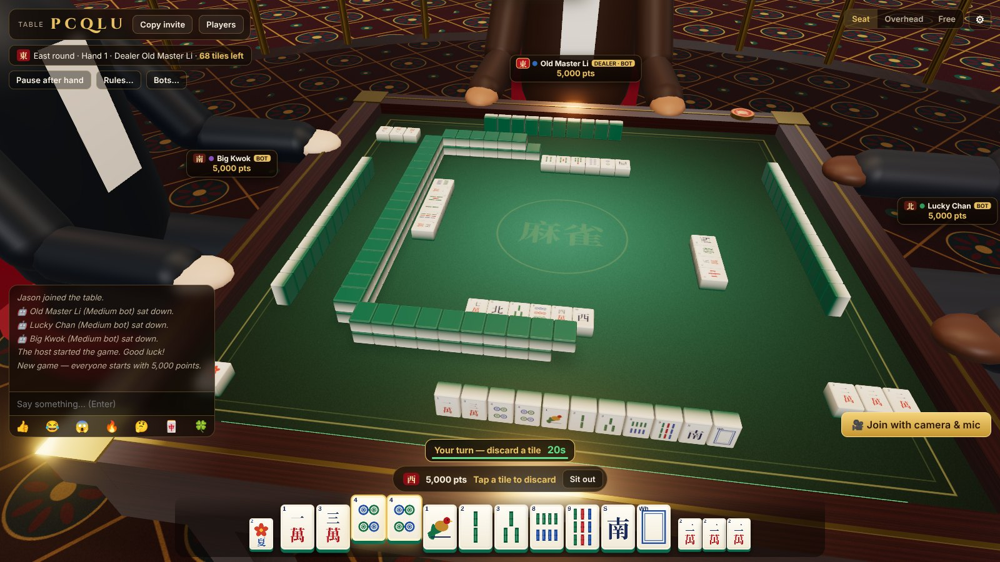
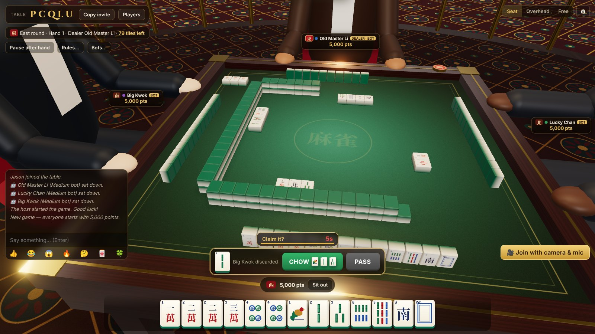
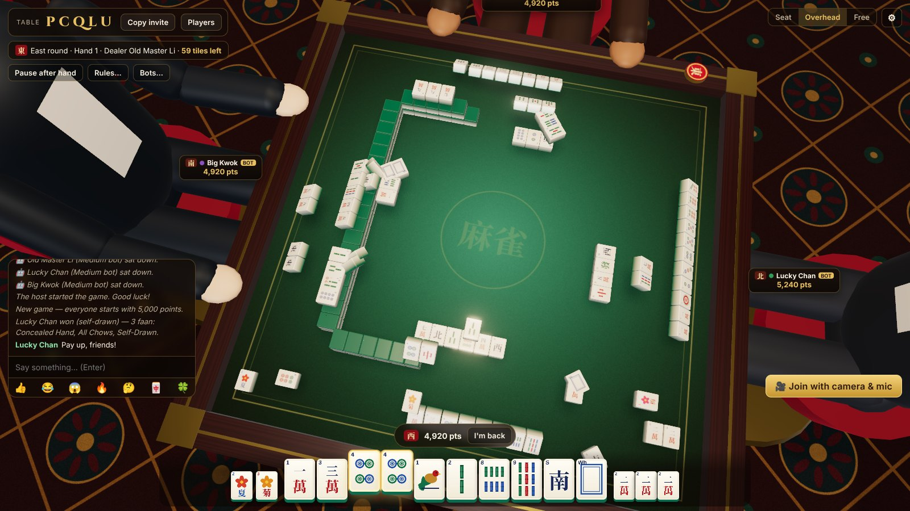

# 🀄 High Roller Mahjong

[](LICENSE)
[](https://guinnessstache.github.io/high-roller-mahjong/)

**[Project website](https://guinnessstache.github.io/high-roller-mahjong/)** · [Quick start](#run-it-on-your-pc) · [Rules & scoring](#rules-and-scoring) · [Steam build](STEAM.md)



A 3D multiplayer **Hong Kong Mahjong** game. You sit at a rosewood mahjong table in a Macau-style casino, with red lanterns, slot banks, roulette, a bar and neon around you. Invite friends with a 5-letter table code, or fill the table with bots. Everyone can turn on a **webcam and mic**, and your face shows up over your seat.

It's the sister game of [High Roller Hold'em](https://github.com/Guinnessstache/vegas-poker) and shares its casino, rooms, video chat, controller support and Steam layer. All tile art is drawn in code; the Chinese characters come from a 17 KB subset of Noto Serif CJK (SIL OFL) bundled in `public/fonts/`.

| Claiming a discard | Overhead view |
|---|---|
|  |  |

## Features

- **Rooms with codes.** The host creates a table and gets a code like `K7QXP`. Friends type the code or open the invite link (`/?room=K7QXP`). Four players sit; bots fill empty seats and hand their seat (and points) to a friend who joins between hands.
- **Hong Kong rules, enforced by the server.** 144 tiles with flowers and seasons (or 136 without), dealing and flower replacement, draws from the wall and replacement draws from the back, pung/kong/chow/win claims with the right priority (win beats pung/kong beats chow; nearest player wins ties), concealed and added kongs, robbing the kong, dealer repeats, wind rounds and game end. Your tiles are only ever sent to you.
- **Faan scoring.** Every winning split of the hand is scored and the best one counts. Payouts follow the half-spicy table: the discarder pays the full value, or on a self-drawn win everyone pays half. See [Rules and scoring](#rules-and-scoring).
- **Computer opponents.** *Play vs bots* starts an instant table. Easy bots grab every claim and ignore faan; Medium bots play for tile efficiency and steer toward hands that meet the faan minimum; Hard bots also count visible tiles and play defense late in the hand.
- **3D table.** Every tile is one physical object: it leaves the wall, lands in a hand, clacks into the discard pinwheel, or is claimed into a meld. Hands are laid face up at the end. Seated, overhead and free-orbit cameras.
- **Helpful HUD.** Your tiles on a rack you can tap; claim buttons that show the tile and faan; *ready hints* that mark which discards leave you one tile from winning and show what you're waiting on; a results panel with the winning hand, the faan breakdown and payments; and a built-in scoring guide.
- **Webcam + mic.** Peer-to-peer WebRTC video appears as a portrait over each player's seat. A green ring shows who is talking.
- **Table talk.** Chat, emoji reactions and synthesized tile clacks, shuffles and casino ambience (Web Audio).
- **Keyboard:** `←`/`→` pick a tile · `Enter` discard · `W` Mahjong · `P` pung · `K` kong · `C` chow · `X` pass · `V` camera.
- **Controller:** LB/RB pick a tile · Ⓐ discard or claim · Ⓧ pass · Ⓨ Mahjong · Ⓑ kong · D-pad moves through menus · ☰ settings · ⧉ camera. Works with Xbox, PlayStation, Switch Pro and Steam Deck.
- **Achievements:** 20 of them, unlocked on Steam in the desktop build (see `steam/ACHIEVEMENTS.md`).

## Run it on your PC

Needs Node.js 18+ (`node -v`).

```bash
npm install
npm start
```

Open http://localhost:3000, enter a name and click **Play vs bots** (or **Create table** and share the code).

## Let friends join

Browsers only allow camera/mic on **HTTPS** pages (or `localhost`), so friends need an HTTPS link:

```bash
# Windows:  winget install --id Cloudflare.cloudflared
cloudflared tunnel --url http://localhost:3000
```

Open the `https://….trycloudflare.com` link it prints, create a table and click **Copy invite**. Or deploy it: [](https://render.com/deploy?repo=https://github.com/Guinnessstache/high-roller-mahjong) (uses `render.yaml`), or any Docker host with the included `Dockerfile`.

The Steam desktop build needs no server at all; see [STEAM.md](STEAM.md).

## Rules and scoring

A hand is four sets (pung, kong or chow) plus a pair, or one of the special hands. You need the table's **minimum faan** to win (default 3). Hands are capped at the **limit** (default 10).

| Faan | Pattern |
|---|---|
| 1 | Self-drawn · Concealed hand · Last tile / last discard · Win on a kong · Robbing the kong |
| 1 | No flowers · Seat flower · Seat season (2 for all four flowers or all four seasons) |
| 1 | Dragon pung (each) · Seat wind pung · Round wind pung · All Chows · Mixed Terminals |
| 3 | All Pungs · Mixed One Suit |
| 4 | Seven Pairs (house rule, off by default) |
| 5 | Small Three Dragons |
| 7 | Pure One Suit |
| 8 | Great Three Dragons |
| Limit | Thirteen Orphans · Four Concealed Pungs · All Honors · All Terminals · Great/Small Four Winds · Four Kongs · Nine Gates · Heavenly / Earthly Hand |

**Payouts** (points × the table's unit): 0–10 faan pays 2, 4, 8, 16, 32, 48, 64, 96, 128, 192, 256. The discarder pays that amount; on a self-drawn win each other player pays half. The dealer keeps the deal after a win or a draw; otherwise it passes, and the round wind advances once every seat has dealt. A game is the East round by default (East + South or a full game are options).

## Project layout

```
server/
  index.js      Express + Socket.IO: static files, /api/ice, socket events
  rooms.js      Table codes, seating, host controls, turn and claim timers, autopilot, chat, signaling
  mahjong.js    Authoritative Hong Kong Mahjong engine (pure logic)
  scoring.js    Hand decomposition, faan scoring, payouts, shanten/waits (shared with the browser)
  tiles.js      Tile kinds and names (shared with the browser)
  bots.js       Computer players: shanten + live outs, faan planning, defense
  awards.js     Achievement detection
public/
  js/main.js    Lobby, HUD (tile rack, claims, results), socket wiring
  js/game.js    Turns server state/events into 3D tile movement
  js/scene/     Three.js world: casino, table, tiles, tile faces, avatars, textures
desktop/        Electron + Steam (player-hosted tables over Steam P2P)
test/           scoring, full bot games, end-to-end server test
docs/           Project website (GitHub Pages). `npm run docs:sync` refreshes its copy of the 3D modules.
```

`npm test` runs the scoring tests, 8 full bot-vs-bot games that check every tile and point is accounted for after every action, and a real Socket.IO game against three bots.

Play points only. There is no real-money gambling.
