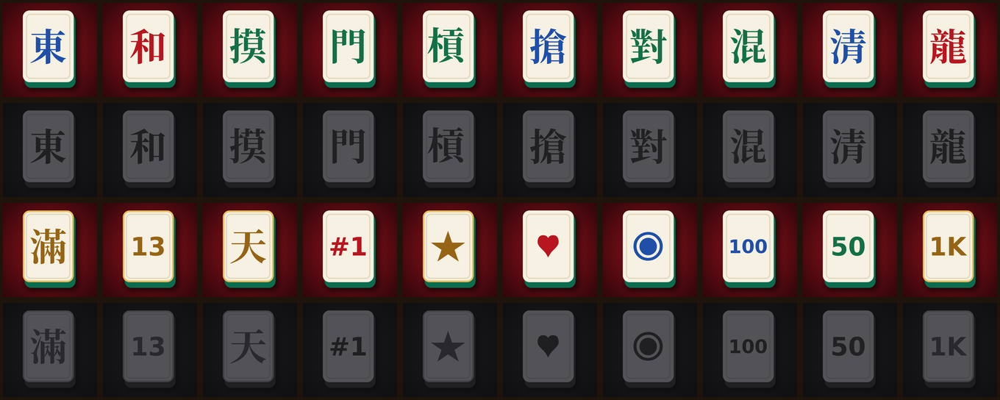

# Steam achievements

Enter these in **Steamworks → your app → Edit Steamworks Settings → Stats & Achievements → Achievements**,
then **Publish** (Steamworks changes don't go live until published).

For each row: *New Achievement* → API Name, Display Name, Description, and upload the two icons from
`steam/achievements/` (achieved = `NAME.jpg`, unachieved = `NAME_locked.jpg`, 64×64).
Leave "Hidden" off and "Set by" = Client. No Steam stats are needed: running totals are kept by the game.

The API Name must match exactly; the game unlocks achievements by these names
(list lives in `public/js/achievements.js`; regenerate this file with `node tools/achievements-sheet.mjs`,
icons with `python tools/make-achievement-icons.py`).

| # | API Name | Display Name | Description | Icons |
|---|---|---|---|---|
| 1 | `FIRST_HAND` | Pull Up a Chair | Play your first hand. | `FIRST_HAND.jpg` / `FIRST_HAND_locked.jpg` |
| 2 | `FIRST_WIN` | Sik Wu! | Win your first hand. | `FIRST_WIN.jpg` / `FIRST_WIN_locked.jpg` |
| 3 | `SELF_DRAWN` | Self-Made | Win on a tile you drew yourself. | `SELF_DRAWN.jpg` / `SELF_DRAWN_locked.jpg` |
| 4 | `CONCEALED_WIN` | Poker Face | Win without claiming a single discard. | `CONCEALED_WIN.jpg` / `CONCEALED_WIN_locked.jpg` |
| 5 | `KONG_WIN` | Flower on the Kong | Win on the replacement tile after a kong. | `KONG_WIN.jpg` / `KONG_WIN_locked.jpg` |
| 6 | `ROB_KONG` | Daylight Robbery | Win by robbing someone’s kong. | `ROB_KONG.jpg` / `ROB_KONG_locked.jpg` |
| 7 | `ALL_PUNGS` | Pung Crazy | Win with All Pungs. | `ALL_PUNGS.jpg` / `ALL_PUNGS_locked.jpg` |
| 8 | `MIXED_SUIT` | Half Measures | Win with Mixed One Suit. | `MIXED_SUIT.jpg` / `MIXED_SUIT_locked.jpg` |
| 9 | `PURE_SUIT` | One Suit Wonder | Win with Pure One Suit. | `PURE_SUIT.jpg` / `PURE_SUIT_locked.jpg` |
| 10 | `DRAGONS` | Dragon Tamer | Win with Small or Great Three Dragons. | `DRAGONS.jpg` / `DRAGONS_locked.jpg` |
| 11 | `LIMIT_HAND` | Over the Limit | Win a limit hand. | `LIMIT_HAND.jpg` / `LIMIT_HAND_locked.jpg` |
| 12 | `THIRTEEN_ORPHANS` | Thirteen Orphans | Win with one of every terminal and honor. | `THIRTEEN_ORPHANS.jpg` / `THIRTEEN_ORPHANS_locked.jpg` |
| 13 | `HEAVENLY` | Blessed by Heaven | Win with the tiles you were dealt. | `HEAVENLY.jpg` / `HEAVENLY_locked.jpg` |
| 14 | `GAME_WIN` | Table Champion | Finish a full game with the most points. | `GAME_WIN.jpg` / `GAME_WIN_locked.jpg` |
| 15 | `HARD_WIN` | Beat the Masters | Finish first in a game with three Hard bots. | `HARD_WIN.jpg` / `HARD_WIN_locked.jpg` |
| 16 | `FRIENDLY_GAME` | Friendly Game | Play a hand with a friend at the table. | `FRIENDLY_GAME.jpg` / `FRIENDLY_GAME_locked.jpg` |
| 17 | `SAY_CHEESE` | Say Cheese | Sit at the table with your camera on. | `SAY_CHEESE.jpg` / `SAY_CHEESE_locked.jpg` |
| 18 | `HANDS_100` | Regular | Play 100 hands. | `HANDS_100.jpg` / `HANDS_100_locked.jpg` |
| 19 | `WINS_50` | Tile Shark | Win 50 hands. | `WINS_50.jpg` / `WINS_50_locked.jpg` |
| 20 | `HANDS_1000` | Mahjong Master | Play 1,000 hands. | `HANDS_1000.jpg` / `HANDS_1000_locked.jpg` |

